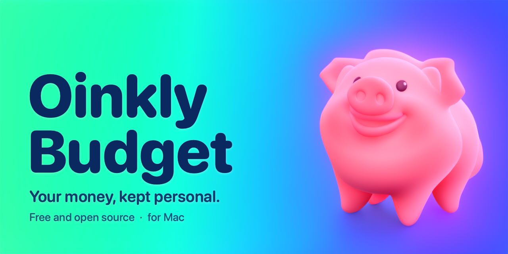

# Oinkly Budget

**Your money, kept personal.** A free, open-source personal finance app for the Mac.

Oinkly Budget keeps your accounts, bills, budgets, goals, investments and debts in one place, on your own Mac. There is no bank linking, no account to create, no sign-in and no network use: your data never leaves your computer unless you export it yourself.

> **Current version: 1.0.1.** A small fix to the first open-source release, 1.0 (build 6). Free and open source under the GNU General Public License v3.

---

## Now open source

The source code is on GitHub: <https://github.com/vaultstudio-main/Oinkly-Budget>.

Oinkly Budget is released as free software under the **[GNU General Public License, version 3](LICENSE)**. In plain terms:

- You can read all of the code, run it, change it and share it.
- If you share a changed version, it has to stay open under the same license.
- It stays free for everyone, and nobody can close it up and sell it as their own.

The roadmap, the plans for future releases and the other planning notes are kept in the open, in [Documents/](Documents/). If you want to know what is coming and why, start there.

### Latest update: 1.0.1

Version 1.0.1 is a small bug-fix release. I accidentally forgot to let the app scale properly to different screen sizes, so it looked cramped or lost in empty space on some Macs, with some tabs running off the edge of the window. This update fixes that:

- Pages now flow with the window and scale up on large screens, such as a 27-inch 4K or 5K display.
- Tabs shrink and then wrap onto a second row, so every tab is always on screen.
- The editor pop-ups shrink to fit smaller screens, such as a 14-inch MacBook, and scroll so Save can always be reached.
- The Planning War Room's pull-out card stacks its figures above the chart when the window is narrow.

Nothing else changed: your data stays on your Mac, and your data is kept as it is when you update from 1.0. Download it from the [1.0.1 release](https://github.com/vaultstudio-main/Oinkly-Budget/releases/tag/v1.0.1).

### Updates

Oinkly Budget is a small, independent project. The aim is to keep improving it with regular, careful updates, and builds will keep coming as time allows. There is no fixed schedule, so please don't expect a release every week, but the project is active and will keep moving. Each release is listed in the app under **Help ▸ Release Notes**.

---

## Download

Ready-to-run builds are published as `.dmg` files on the project's **[1.0.1 release](https://github.com/vaultstudio-main/Oinkly-Budget/releases/tag/v1.0.1)**. Download the `.dmg`, open it and drag Oinkly Budget to your Applications folder.

If you would rather build it yourself, see [Building from source](#building-from-source).

---

## What it does

**Accounts of every kind.** Checking, savings, cash, credit cards, loans, mortgages, investments and assets. Cash on Hand is built in, every bank account starts with a real opening deposit so the register and the balance always agree, and credit limits are enforced: a charge that would reach a card's limit is stopped before it is saved.

**Transactions you can trust.** A register for every account and one page with all of them together. Split a payment across categories, tag it, attach a receipt photo or a PDF bill, and fill in repeat payees automatically. Reconcile against your statement. Clean Up finds and fixes look-alike payees in bulk, with Undo.

**Bills and recurring transactions.** A bills calendar with reminders, one-step payments that come out of the account, come off what you owe and tick the bill off, and repeating transactions (paycheques, rent and so on) that wait for you to confirm them.

**Budgets that match how you spend.** Monthly and weekly budgets by category, grouped into folders, with cash budgets and tax-related categories. Icons and colours for every category, bill and goal.

**Planning.** Savings goals and loan-payoff goals tied to real accounts, so progress follows the balance by itself. A **Planning War Room** that sets your plan against what is really happening, with a War Plan sheet to plan a month line by line, mark the lines that go to your Debt or Savings War Plan, and see when spare money can safely come out.

**Reports and overviews.** A Summary page, Liabilities with payoff progress for loans and credit cards, Investments, and reports with projections for net worth, cash flow, debt, goals, budgets, spending, income and bills.

**Import, export and backup.** Import any bank's CSV (formats can be saved), export CSV and PDF, and save everything to one `.pig` backup file that restores whole. A safety copy of your data is made before an upgrade first opens it, and an optional backup folder keeps a second copy up to date by itself.

**Menu bar and widget.** An Upcoming Transactions list (bills, repeating transactions, reminders) in the menu bar and as a widget, without amounts.

The full list, release by release, is in **Help ▸ Release Notes** inside the app.

---

## Privacy

- No network access, no analytics, no accounts, nothing sent anywhere.
- Your data is stored in a local database on your Mac.
- The app does no encryption of its own: the data file is plain, so rely on your Mac's own protection (FileVault and your login) for that.
- Reminders, saved import formats and picture colours are stored with your data, so a backup carries them.

---

## Requirements

- A Mac running **macOS 15 or later**.
- To build it yourself: **Xcode** (recent version) on a Mac.

---

## Building from source

1. Clone this repository.
2. Open `OinklyBudget/OinklyBudget.xcodeproj` in Xcode.
3. Choose the **OinklyBudget** scheme and **My Mac**, then Run (⌘R).

The project has the app and a widget extension, and shared code in `OinklyBudget/Shared`. You will need to choose your own signing team (and bundle identifier if you plan to distribute your own build) in the project settings.

Debug builds add a few things that release builds leave out: a **Testing** menu item that fills the app with made-up test data or wipes it, and launch tests for data safety (run the app with `-sharedHardeningTest YES` to run them). Do not point a debug build at data you care about.

---

## Where things are

| Folder | What is in it |
|---|---|
| `OinklyBudget/` | The Xcode project: the app, the widget extension and the shared code |
| `Documents/` | Where the plan files go: the roadmap, plans for future releases and other planning notes (see [Documents/README.md](Documents/README.md)) |
| `LICENSE` | The GNU General Public License, version 3 |

Inside `OinklyBudget/OinklyBudget/`: `Models/` holds the data (SwiftData, currently schema V9, with a migration plan carrying every earlier version forward), `Logic/` holds the rules and calculations, and `Views/` holds the screens.

---

## Contributing

Ideas, bug reports and fixes are welcome. Before starting on something big, have a look at [Documents/](Documents/) to see whether it is already planned, and open an issue to talk it through. Anything you contribute is shared under the same GPL v3 license as the rest of the project.

Please keep to what the app stands for: your money stays on your Mac, mistakes are hard to make, and changes to people's data are deliberate and reversible.

---

## License

Oinkly Budget is free software: you can redistribute it and change it under the terms of the [GNU General Public License](LICENSE) as published by the Free Software Foundation, version 3 of the License. It is distributed in the hope that it will be useful, but **without any warranty**, without even the implied warranty of merchantability or fitness for a particular purpose. See the license for details, or read it at <https://www.gnu.org/licenses/gpl-3.0.html>.
